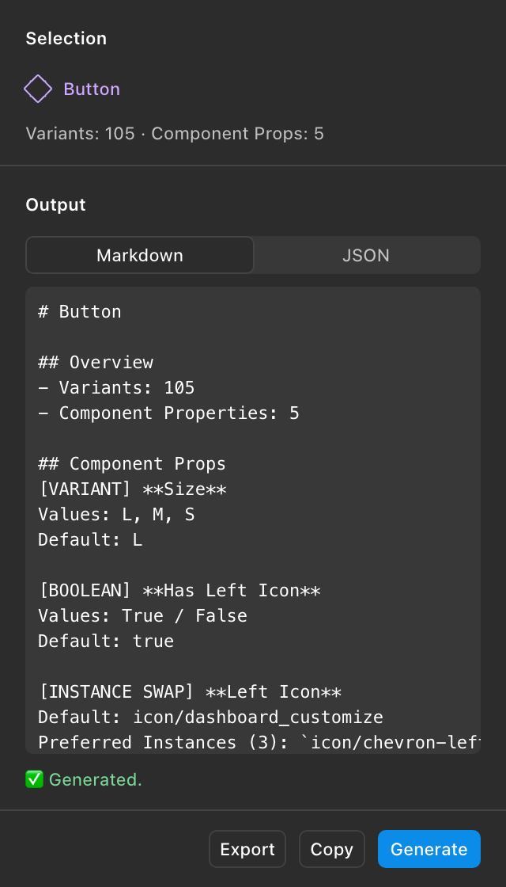
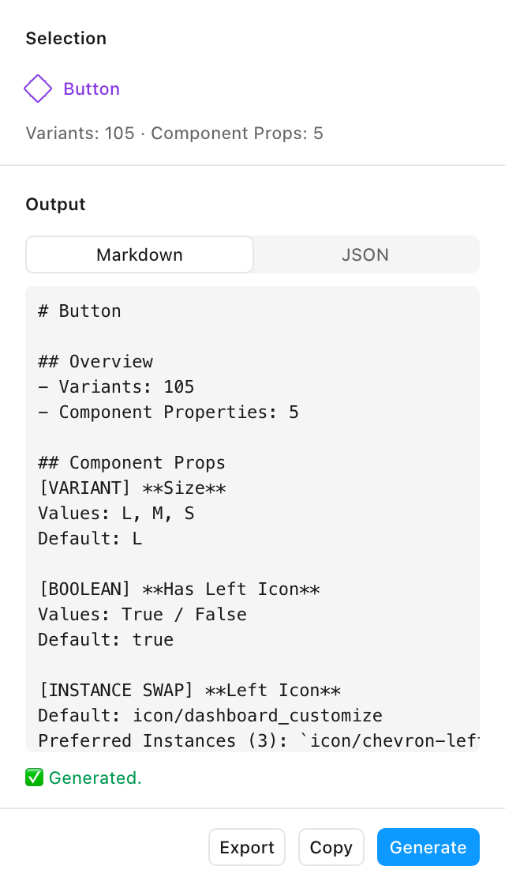

# Export Component Metadata

A Figma plugin that turns the properties of a **Component** or **Component Set** into documentation: readable **Markdown** and structured **JSON**, ready for Zeroheight, Supernova, Storybook or your own tooling.

<p>
  
  
</p>

---

## Features

- **Markdown and JSON in one click.** Both formats are generated together; switch between them with the segmented control.
- **Every component property type:**
  - `VARIANT` — values and default variant
  - `BOOLEAN` — default value
  - `TEXT` — default text
  - `INSTANCE_SWAP` — default component and preferred instances, resolved to component names
- **Works from any selection.** Select a Component Set, one of its variants, a single Component or an Instance; the plugin resolves it to the main component or set.
- **Readable order.** Variants first, then the other properties with each `Has X` boolean right before the `X` it controls.
- **Copy and Export.** Copy the active output to the clipboard or save the JSON as `<Component name>.json`.
- **Native Figma look.** Built with [FigUI3](https://github.com/rogie/figui3) and Figma's theme tokens, so it follows Figma's light and dark themes.

---

## Usage

1. Select a Component, Component Set or Instance in Figma.
2. Run **Plugins → Export Component Metadata**.
3. Click **Generate**.
4. Pick **Markdown** or **JSON**, then **Copy** it or **Export** the JSON file.

The Selection section shows the detected component with its variant and property counts, and updates as you change the selection.

---

## Output

### Markdown

```markdown
# Button

## Overview
- Variants: 105
- Component Properties: 5

## Component Props
[VARIANT] **Size**  
Values: L, M, S  
Default: L

[BOOLEAN] **Has Left Icon**  
Values: True / False  
Default: true

[INSTANCE SWAP] **Left Icon**  
Default: icon/dashboard_customize  
Preferred Instances (3): `icon/chevron-left`, `icon/back`, `icon/menu`

[TEXT] **Label**  
Default: Body text
```

Each line of a property block ends with two spaces, so it renders as separate lines in Markdown.

### JSON

`componentProps` keeps the raw values from the Figma API (node ids, component keys); `pretty` is a simplified view with resolved names.

```json
{
  "name": "Button",
  "overview": { "variantsCount": 105, "componentPropsCount": 5 },
  "componentProps": [
    { "name": "Size", "type": "VARIANT", "defaultValue": "L", "variantOptions": ["L", "M", "S"] },
    {
      "name": "Left Icon",
      "type": "INSTANCE_SWAP",
      "defaultValue": "10:1",
      "defaultInstanceName": "icon/dashboard_customize",
      "preferredValuesCount": 3,
      "preferredValuesRaw": [{ "type": "COMPONENT", "key": "a1b2c3…" }],
      "preferredInstanceNames": ["icon/chevron-left", "icon/back", "icon/menu"]
    }
  ],
  "pretty": {
    "componentProps": [
      { "name": "Size", "type": "VARIANT", "default": "L", "values": ["L", "M", "S"] },
      {
        "name": "Left Icon",
        "type": "INSTANCE_SWAP",
        "default": "icon/dashboard_customize",
        "preferredInstancesCount": 3,
        "preferredInstances": ["icon/chevron-left", "icon/back", "icon/menu"]
      }
    ]
  }
}
```

### Notes and limits

- **Property order** is a heuristic: the Plugin API doesn't expose the order of Figma's properties panel.
- **Preferred instances** are stored by Figma as component keys. The plugin looks them up among the file's components first, then imports them from published libraries. Components that are in neither place are counted as "not resolved".
- To find local components the plugin loads every page of the file (`figma.loadAllPagesAsync()`), only when the component has preferred instances. On very large files this can take a moment.

---

## Development

Requirements: Node.js 20.19+ or 22.12+ (required by Vite 8).

```bash
npm install
npm run build
```

Then, in the Figma desktop app, go to **Plugins → Development → Import plugin from manifest…** and pick this project's `manifest.json`.

| Script | What it does |
|---|---|
| `npm run build` | Compiles `code.ts` → `code.js` and bundles the UI → `dist/ui.html` |
| `npm run build:code` / `npm run build:ui` | Each half of the build on its own |
| `npm run watch` / `npm run watch:ui` | Rebuild the plugin code or the UI on change |
| `npm run lint` | ESLint with Figma's plugin rules |

`code.js` and `dist/` are build output and aren't committed.

### Project structure

```
code.ts           Plugin logic (runs in Figma's sandbox)
ui/
  index.html      UI markup (fig-* web components)
  main.js         UI logic and messaging
  styles.css      Layout with Figma tokens only
  icons.js        SVG icons not included in FigUI3
vite.config.mjs   Bundles ui/ into a single dist/ui.html (Figma requires one HTML file)
manifest.json     Figma plugin manifest
```

### UI ↔ plugin messages

| Direction | Type | Payload |
|---|---|---|
| UI → plugin | `ui-ready` | — |
| UI → plugin | `ui-generate` | — |
| UI → plugin | `ui-export` | `{ payload }` — the JSON text to save |
| plugin → UI | `selection-info` | `{ name, variantCount, propsCount }` |
| plugin → UI | `generation-result` | `{ format: 'md' \| 'json', output }` — sent for both formats, also on errors |
| plugin → UI | `status` | `{ message }` |
| plugin → UI | `download` | `{ filename, content }` |

### Tech stack

- **Plugin:** TypeScript, Figma Plugin API (`documentAccess: dynamic-page`, async APIs only)
- **UI:** [FigUI3](https://github.com/rogie/figui3) core components (MIT), plain JavaScript, Figma `--figma-color-*` tokens via `themeColors`
- **Build:** `tsc` for the plugin, Vite + `vite-plugin-singlefile` for the UI
- **Network:** none; the manifest allows no domains and the UI loads nothing remotely

---

## Changelog

See [CHANGELOG.md](CHANGELOG.md).

## Author

**Maximiliano Avendaño Rincón** — Design Systems Engineer · Santiago, Chile
GitHub: [@maxavend](https://github.com/maxavend)

## License

[MIT](LICENSE)
