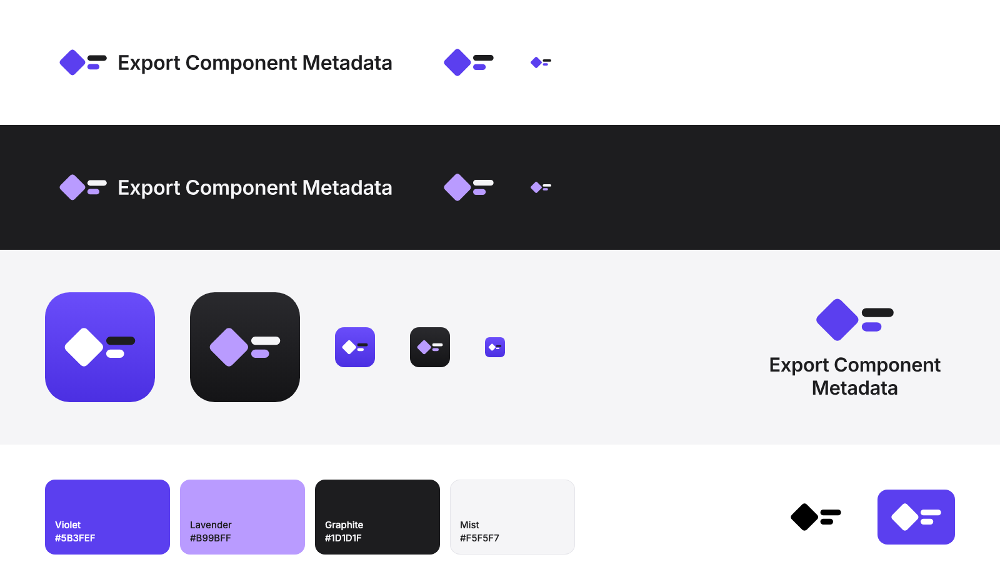

# Brand — Export Component Metadata



## The idea

**Key–value.** Figma's component diamond next to two lines: a property's key and its value — what the plugin reads out of every component. The value line shares the diamond's colour, because the value comes from the component; the key is in the colour of text.

Nothing in it is arbitrary. Every measure comes from the diamond:

- The key line is as long as the diamond's side; the value line is the key divided by the golden ratio.
- One gutter everywhere: the space between the two lines is the space between the diamond and the lines, measured from the diamond's rounded tip.
- The pointed tips overshoot slightly, so the diamond looks as tall as it is, and its corners are softened with long, smooth fillets rather than plain arcs.

## Files

| Folder | Contents |
|---|---|
| `symbol/` | The mark on its own: `color` (on light), `on-dark`, `black`, `white`, `violet` |
| `lockup/` | Symbol + name: `horizontal-*` (one line) and `stacked-*` (two lines), same colour schemes |
| `icon/` | App icon: the flat mark on a softly lit tile, in two appearances, `icon-default` and `icon-dark`. `*-rounded` versions have rounded corners, a hairline of light along the top edge and transparent outside; the square ones are full bleed |
| `png/` | Ready-to-use PNG exports: icons at 1024, 512, 256 and 128 px; symbols and lockups 1600 px wide, transparent |
| `src/` | Generators: `mark.py` (geometry and icon) and `build_kit.py` (lockups, with the name outlined from Inter) |

All SVGs are outlined: no live text, no embedded images. The flat marks use solid fills only.

## Colour

| Name | HEX | RGB | Use |
|---|---|---|---|
| Violet | `#5B3FEF` | 91 63 239 | Diamond and value line on light backgrounds; brand colour |
| Lavender | `#B99BFF` | 185 155 255 | Diamond and value line on dark backgrounds |
| Graphite | `#1D1D1F` | 29 29 31 | Key line and name on light backgrounds; key line on the default app icon |
| Mist | `#F5F5F7` | 245 245 247 | Key line and name on dark backgrounds; light surfaces |

App icon backgrounds: default `#6A4DFA → #4B2FE2`, dark `#2A2A2E → #141416` (top to bottom). On the default icon the diamond and value line are white and the key line is Graphite; on the dark one they are Lavender and Mist.

Contrast: Violet on white 6.2:1, white on Violet 6.2:1, Lavender on Graphite 7.4:1. Graphite on the default icon tile is 2.2–3.2:1: enough for a shape this size, but don't use that pairing for text.

## Which version to use

- **App icon** (`icon/`): only where an app icon is expected — the Figma Community listing, the plugin's icon, avatars. Use `icon-default` unless the surface calls for the dark appearance.
- **Flat symbol and lockups** (`symbol/`, `lockup/`): everywhere else — READMEs, docs, slides. Use `color` on light backgrounds and `on-dark` on dark ones; `black`, `white` and `violet` when only one colour is possible.
- **Horizontal lockup** by default; **stacked** when the space is close to square.

## Clear space and minimum sizes

- Keep free space around the lockups equal to the **cap height of the name** (the height of the "E"); around the symbol, half the height of the diamond.
- Minimum sizes: symbol **16 px** tall; horizontal lockup **180 px** wide; stacked lockup **96 px** wide; app icon **24 px**.

## Please don't

- Recolour the mark outside the palette, or break the colour logic: the diamond and the value line always share a colour, the key line takes the colour of text.
- Add glows, shadows, gradients or outlines to the flat symbol and lockups. The depth belongs to the app icon only.
- Move, resize or reorder the diamond and the lines, swap the key and value lines, or set the name in another typeface.
- Stretch, rotate or skew any version.
- Place the `color` version on Violet or busy backgrounds — use `white` instead.

## Typography

The name is set in **Inter Semi Bold** with −1 % tracking — the typeface of Figma's interface — and outlined in the files, so no font is needed to use them. Inter is licensed under the SIL Open Font License.

## Regenerating

`mark.py` has no dependencies. `build_kit.py` needs `fonttools` and `uharfbuzz` and an Inter Semi Bold `.ttf`:

```bash
cd docs/brand/src
python3 build_kit.py .. /path/to/Inter-SemiBold.ttf
```
